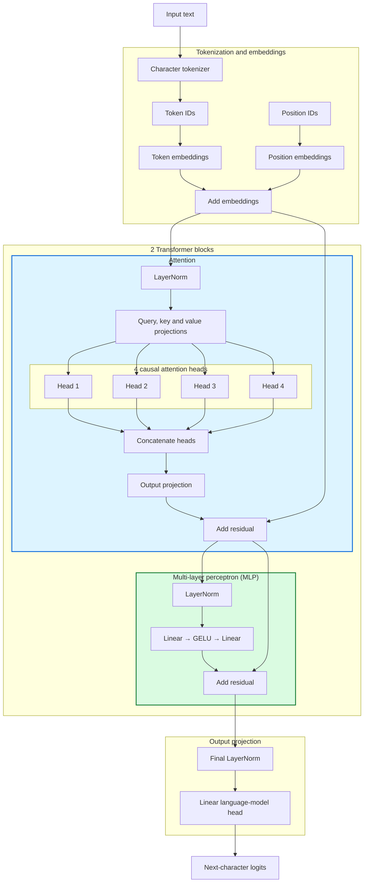

# Pico GPT

> Learning how Transformers work by building a minimal version of GPT-2 from scratch.

I wanted to learn how attention and Transformers work, and what happens inside an LLM when it predicts the next token. Starting with a full-sized model would hide too much. Pico GPT is the smallest version I could build and still follow from input text to generated output.

I kept the parts of GPT-2 I wanted to study: decoder-only blocks, causal self-attention, pre-normalized residual paths, learned embeddings and the GELU feed-forward network. The token embedding also shares its weights with the language-model head.

Everything around that architecture is smaller. One character becomes one token, the corpus is a short set of sentences repeated 200 times and every weight starts from scratch. I left out dropout, distributed training and production optimizations because they would distract from the path I wanted to trace.

## Architecture



## Default Configuration

| Setting | Default | What it controls |
| --- | ---: | --- |
| `block_size` | `64` | Maximum number of tokens the model can read at once |
| `n_embd` | `96` | Size of each token and position embedding |
| `n_layer` | `2` | Number of Transformer blocks |
| `n_head` | `4` | Number of parallel attention heads |
| `vocab_size` | From the corpus | Number of unique characters the model can use |

The tokenizer gives each unique character an integer ID and reverses that mapping after generation. I keep 90% of the corpus for training and 10% for validation. Shifting each input forward by one character creates its targets.

## Training and Generation

I train with AdamW at a learning rate of `3e-4` and weight decay of `0.01`. Cross-entropy compares the predicted character distribution with the expected next character. Every 150 steps, I average 30 training and validation batches to reduce noise in the reported loss.

The script picks CUDA, MPS or CPU and stops after 1,200 steps.

Generation has two paths. With `temperature=0`, the model always picks the most likely next character. A higher temperature makes the choice less predictable, while `top_k` limits that choice to the most likely characters.

## What I Observed

One run on my CUDA setup took about 11 seconds. The model has 232,608 parameters, and its validation loss fell from `3.3579` to `0.0831` over 1,200 steps.

After training, a sampled prompt starting with `the ` produced:

```text
the dog slept beside the fire.
the bird rested in the tree.
the fox watched the quiet field.
```

The clean lines are only part of the output. The same sample later produced `the bird flew over the tre` and `the cathe chased oused the mouse`. That is about right for this corpus: the model copies its sentence patterns, joins some of them and drops characters in others.

The 11-second timing is what this machine managed with CUDA. I have not compared it with other GPUs or treated it as a benchmark.

## Current Limits

The script starts from scratch on every run. It cannot save a checkpoint, resume training or accept command-line options. The learning rate stays fixed.

GPT-2 weights do not fit because the tokenizer and model dimensions are different. So far, I have only run the full training loop with the built-in corpus and default configuration on CUDA.

## Get, Run and Test

Clone the repository and install PyTorch in a virtual environment:

```zsh
git clone git@github.com:ganesshkumar/pico-gpt.git
cd pico-gpt
python -m venv .venv
source .venv/bin/activate
python -m pip install -r requirements.txt
```

Run the model:

```zsh
python pico_gpt.py
```

Run the tests:

```zsh
python -m unittest discover -s tests -v
```

The tests cover tokenization, batch construction, model shapes, causal attention, generation and parameter updates.